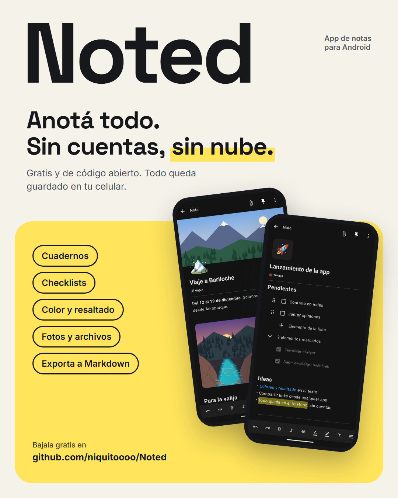
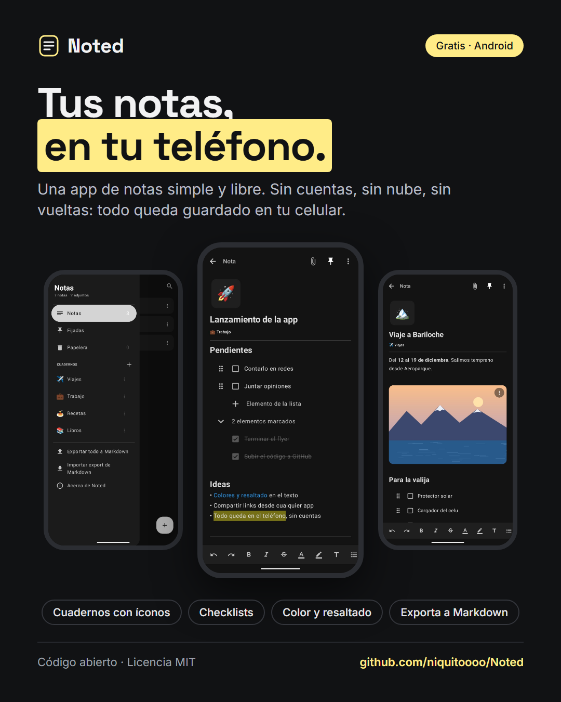

# Noted

App de notas para Android, local-first y open source. Sin cuenta ni servidor: todo
queda en el aparato.

<table align="center">
  <tr>
    <td></td>
    <td></td>
  </tr>
</table>

## Qué hace

- **Edición en vivo**: negrita, cursiva, subrayado, tachado, títulos, citas, listas,
  código, colores y resaltado se ven con formato mientras escribís. El cuerpo de
  cada nota se guarda como HTML.
- **Adjuntos de cualquier tipo y tamaño** (fotos, videos, PDFs, ZIPs, documentos…)
  como bloques entre el texto, en el lugar del cursor. Se pueden pegar desde el
  teclado o el portapapeles, y reordenar arrastrándolos.
- **Galería de fotos y videos** a pantalla completa, con deslizar, pellizco para
  ampliar y modo inmersivo. Reproductor propio (Media3/ExoPlayer) y lector de PDF
  integrado (`PdfRenderer`).
- **Checklists** con casillas, anidado, marcados abajo y arrastre por la agarradera.
- **Bloques desplegables** anidables sin límite, y **notas dentro de notas**.
- **Tarjetas de enlace**: al pegar un link, la app trae título, descripción e
  imagen del sitio y los guarda localmente.
- **Portada e ícono por nota** (emoji o imagen), con encuadre ajustable.
- **Cuadernos**, notas fijadas, orden manual y papelera (también de cuadernos).
- **Búsqueda** en título, texto y enlaces, hecha en la base, sin cargar todo en memoria.
- **Barra del editor configurable**: 18 botones que se ordenan, ocultan y muestran.
- **Deshacer y rehacer** de toda la nota, e historial de versiones del cuerpo.
- **Teclado físico**: atajos con Ctrl, flechas entre bloques y selección con Shift.
- **Importar y exportar en Markdown**, con los adjuntos en una carpeta aparte.
- **Compartir a Noted** desde cualquier app (fotos, videos, PDFs, texto).
- **Material You 3** con color dinámico en Android 12+; en tablets el contenido se
  centra con un ancho máximo legible.

## Instalar

Bajá la APK de la última versión en
[Releases](https://github.com/niquitoooo/Noted/releases/latest) y abrila en el
teléfono (Android 8 o superior). Android te va a pedir permiso para instalar apps
de esa fuente.

## Dónde se guarda

Todo queda en el almacenamiento privado de la app:

- `databases/noted.db` (Room): una fila por nota con el HTML, campos derivados para
  la lista y la búsqueda, y el historial de versiones.
- `files/attachments/<noteId>/`: adjuntos, sin límite de tamaño.
- `files/covers/`, `files/bookmarks/` y `files/icons/`: portadas, tarjetas e íconos.

No hay sincronización a propósito. Para respaldar, usá **Exportar**.

## Compilar

- JDK 17 o superior (probado con JDK 21).
- Android SDK con `compileSdk 35`, y `local.properties` con `sdk.dir=...`.

```bash
./gradlew :app:assembleDebug
# APK: app/build/outputs/apk/debug/app-debug.apk
./gradlew :app:testDebugUnitTest
```

Para firmar el release, creá un `keystore.properties` en la raíz (no va a git) con
`storeFile`, `storePassword`, `keyAlias` y `keyPassword`. Sin ese archivo el release
compila sin firmar.

## Importar notas

Menú lateral → **Importar export de Markdown** → elegí la carpeta. Lee `.md`,
`.markdown` y `.txt`; cada subcarpeta es un cuaderno, y los enlaces a archivos se
resuelven por ruta o por nombre.

## Limitaciones conocidas

- No hay sincronización entre dispositivos (a propósito).
- Las tarjetas de enlace consultan el sitio al insertarse; sin Internet o sin Open
  Graph muestran la URL como título.
- El lector PDF no busca ni selecciona texto (limitación de `PdfRenderer`).
- En tablets no hay vista de dos paneles.

## Licencia

MIT. Ver [LICENSE](LICENSE).
